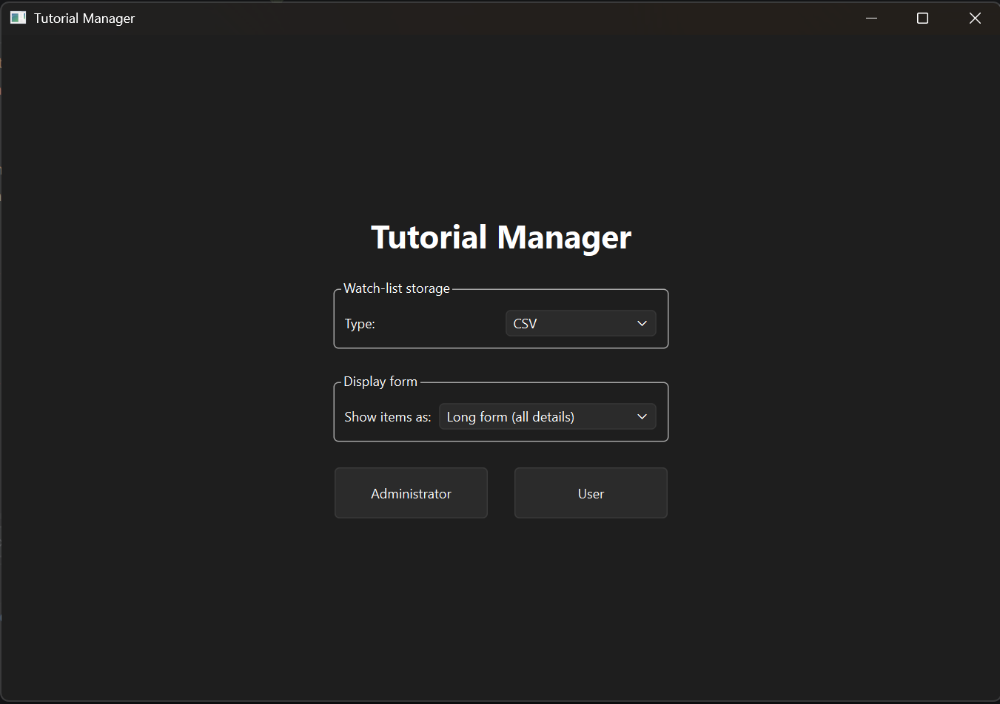
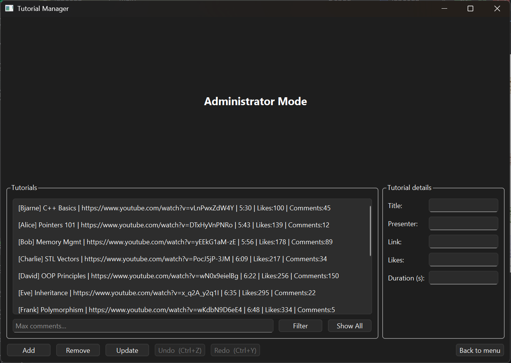
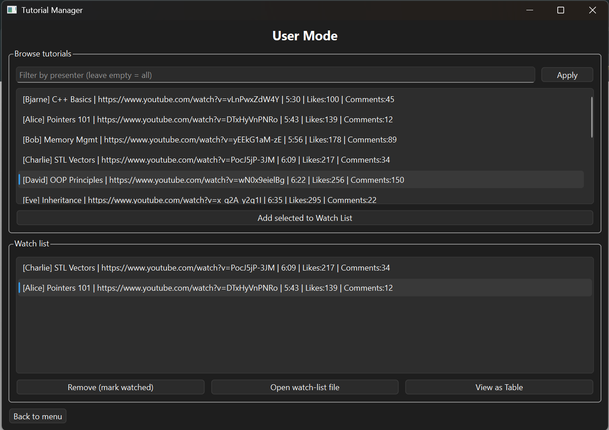
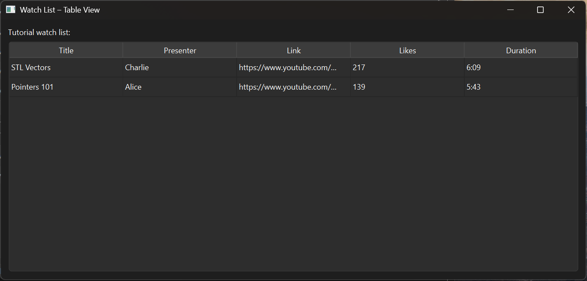
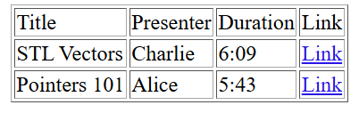
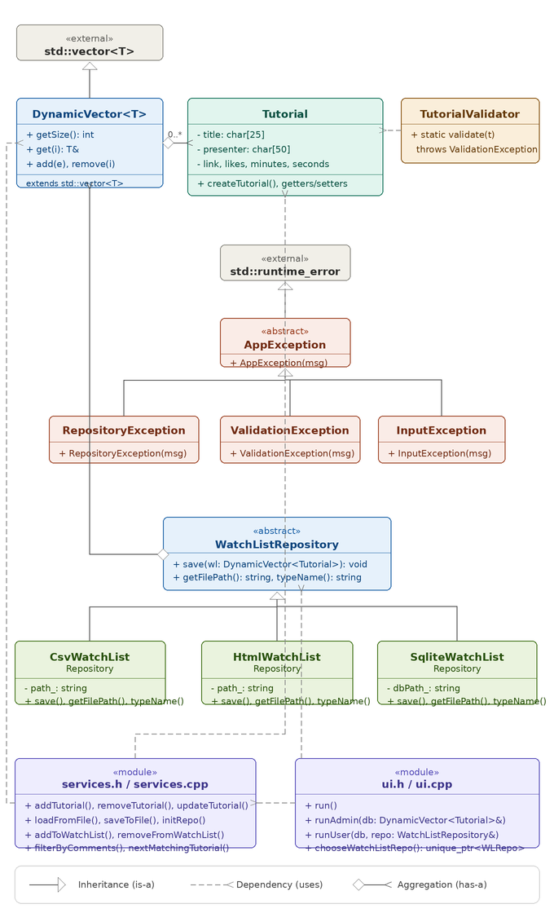

# Tutorial Manager

A C++ desktop app built with **Qt 6** for managing a collection of programming tutorials and building a personal watch list. An **administrator** manages the tutorial database. A **user** browses tutorials by presenter, adds them to a watch list and exports it as CSV, HTML or an SQLite database.

I built it as a university project for an Object-Oriented Programming course. The focus was on OOP design, layered architecture and design patterns in modern C++.

<br>

<p align="center"></p>

## Features

- **Two modes.** You pick Administrator or User mode on the start screen.
- **Administrator mode:**
  - add, remove and update tutorials (title, presenter, duration, likes and link), with input validation
  - **Undo and redo** with buttons or `Ctrl+Z` / `Ctrl+Y`, built with the **Command pattern**
  - filter tutorials by number of comments
- **User mode:**
  - browse tutorials, optionally filtered by presenter
  - add tutorials to your watch list
  - when you remove a watched tutorial, you're asked whether you liked it, and the like is counted
  - view the watch list in a table, built on Qt's model/view (`QAbstractTableModel` + `QTableView`)
  - open the watch list file directly from the app
- **Three ways to save the watch list:** CSV, HTML or SQLite. You choose at startup, and all three share one abstract repository interface.
- **Display options:** a long form with all the details, or a short form with just the title and presenter.
- **Error handling:** custom exception classes for validation and file errors, shown as dialogs.

## Screenshots

| Administrator mode | User mode |
|---|---|
|  |  |

| Watch list as a table | Watch list exported to HTML |
|---|---|
|  |  |

## Architecture

The code is split into layers:

- **Domain:** `Tutorial` and its `Validator`.
- **Repository:** a generic `DynamicVector<T>`, plus the watch-list repositories (`CsvWatchListRepository`, `HtmlWatchListRepository`, `SqliteWatchListRepository`) behind the abstract `WatchListRepository`.
- **Services:** the application logic used by the interface.
- **GUI:** `MainWindow` (a `QStackedWidget` with the mode, admin and user pages), the `WatchListWindow` table and the `TutorialTableModel`.
- **Undo and redo:** `AddCommand`, `RemoveCommand` and `UpdateCommand` share a common `Command` interface.

<p align="center"></p>

## Building it

**Requirements:** C++20, CMake 3.26+ and Qt 6 (Widgets). SQLite is bundled as source, so you don't need to install it.

```bash
git clone https://github.com/Ayiato/tutorial-manager.git
cd tutorial-manager
cmake -B build -DCMAKE_PREFIX_PATH=/path/to/Qt/6.x/<compiler>
cmake --build build
```

Or open the folder in **CLion** or **Qt Creator** and run it from there.

`tutorials.txt` contains sample data. Put it in the folder you run the app from, and the tutorial list will start filled in.

## Tech

C++20 · Qt 6 Widgets · SQLite · CMake · OOP · Command pattern · Model/View
